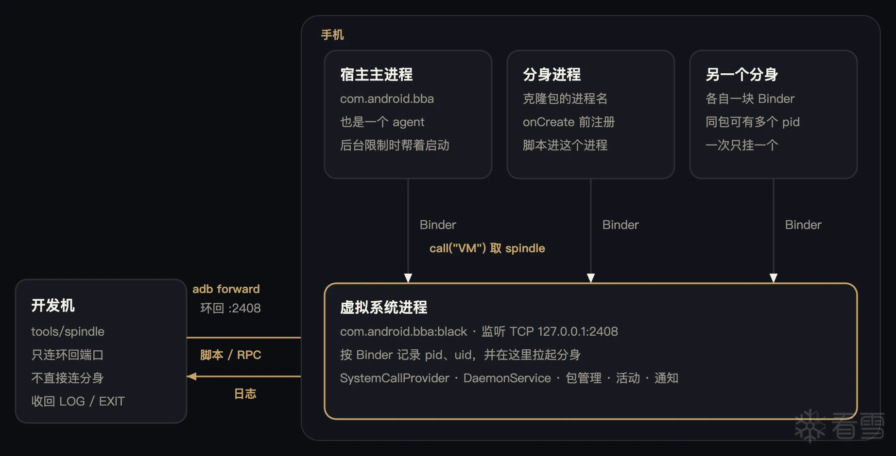

[English](README.md)


# BBA

Spindle 是命令行客户端。它把一段脚本送进 BBA 宿主，或送进某一个分身，再把日志打回来。参数对齐 Frida 命令行：`-f` 拉起，`-n` 或 `-p` 挂上，`-l` 加载脚本。

BBA 本身是一个 Android 应用分身沙箱。宿主包名 `com.android.bba`。分身跑在这个包里，不是系统里单独装出来的应用。先装进沙箱，从 BBA 界面打开分身，再用 Spindle。脚本只在 **arm64** 上跑，由 QuickJS 执行，带 Frida Gum 的 Interceptor 和 Stalker。



开发机不直接连分身。它只连虚拟系统进程 `com.android.bba:black` 的 `127.0.0.1:2408`。宿主主进程和每个分身都是 agent：通过 Binder 注册、收脚本、回日志。USB 模式会自己做 `adb forward tcp:0 tcp:2408`。

## 拉起、挂接、列表

仓库根目录，只插着一台设备：

```bash
# 停掉 user 0 上的分身，再启动、注入，然后放行
python3 tools/spindle -U -f com.example.app -l tools/test_js_api.js

# 挂到已经在跑的分身
python3 tools/spindle -U -n com.example.app -l tools/test_native_hook.js

# 按 pid 挂，宿主界面进程 com.android.bba 也可以
python3 tools/spindle -U -p 12345 -l tools/test_js_api.js

# 不写文件，直接塞一行
python3 tools/spindle -U -n com.example.app -e 'console.log("hi")'

# 已经注册的进程，JSON
python3 tools/spindle -U --list

# 同一份列表，打成表
python3 tools/spindle-ps -U
```

`-f` 是拉起。客户端先把脚本送进去，再送 `UNLOCK`。分身在启动路径上等到这一帧，所以脚本会赶在 `Application.onCreate` 之前就位。`-f` 只用 user 0。

`-n` 和 `-p` 是挂接。进程必须已经注册。名字是 Spindle 记下的进程名，一般就是分身包名。宿主界面进程是 `com.android.bba`。

多台手机：

```bash
python3 tools/spindle -D <serial> -n com.example.app -l tools/test_js_api.js
```

端口已经转好了，就不用 adb：

```bash
python3 tools/spindle -H 127.0.0.1:2408 -n com.example.app -l tools/test_js_api.js
```

`-H`、`-U`、`-D` 选连接，只写其中一个。`-f`、`-n`、`-p` 也只写其中一个。

客户端会停在那里，把 `console.log` 打出来，直到进程退出、服务断开，或者你按 Ctrl-C。

## 脚本

脚本就是一段 JavaScript。示例在 `tools/`：

| 文件 | 做什么 |
| --- | --- |
| `test_js_api.js` | `Memory`、指针、`Module`、`Interceptor` |
| `test_native_hook.js` | `Interceptor.attach("libz.so!deflate", …)` |
| `test_java_hook.js` | 对 `Activity.onCreate` 做 `Java.hook` |
| `test_stalker.js` | 在 hook 里 `Stalker.follow` |
| `test_rpc.js` | 从命令行调 `rpc.exports` |

`console.log` 会作为一行日志回来。armeabi-v7a 没有运行时，那边的 RPC 会回 `js runtime is not in bba`。

脚本加载之后可以调导出。`--args` 是 JSON 数组，和对应的 `--call` 对齐：

```bash
python3 tools/spindle -U -n com.example.app -l tools/test_rpc.js --call ping --args '["hi"]'
```

这行会打出 `pong hi`，然后继续等日志。
